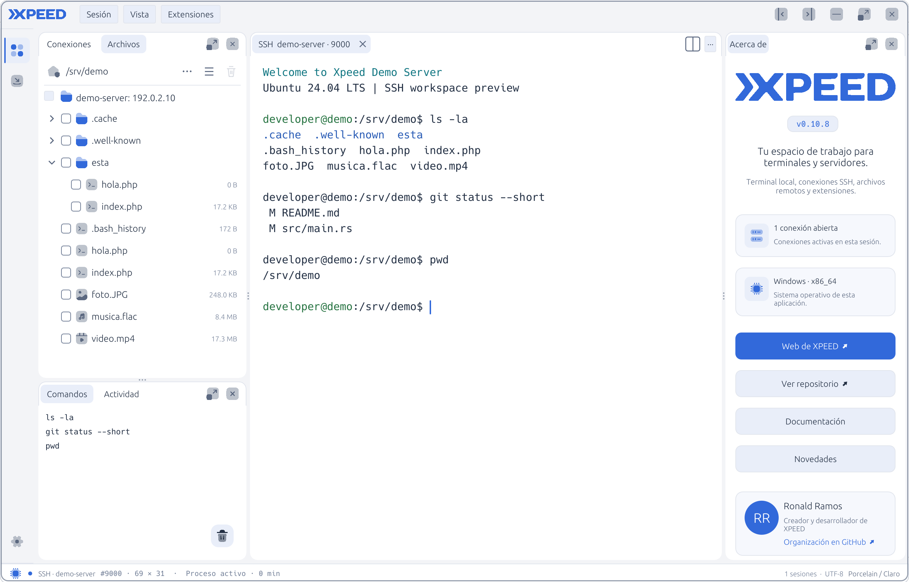
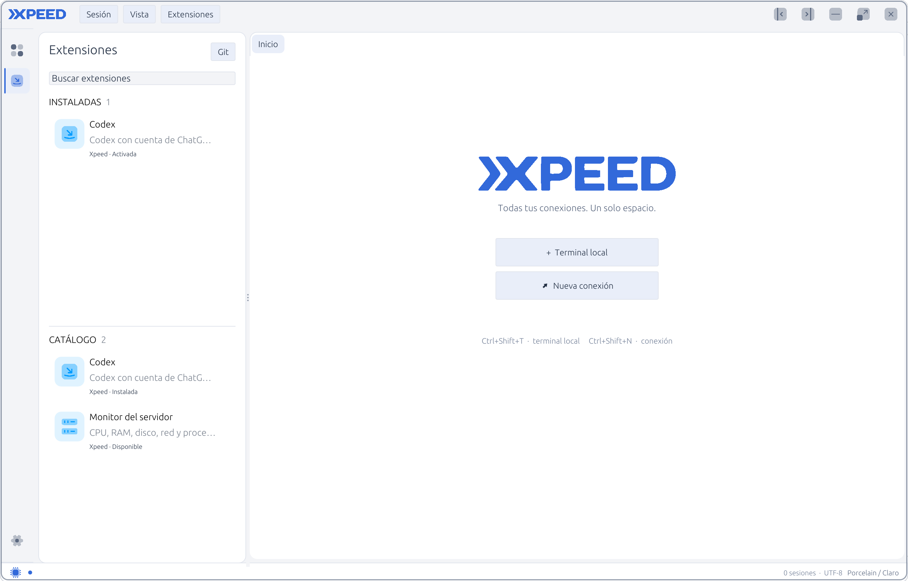
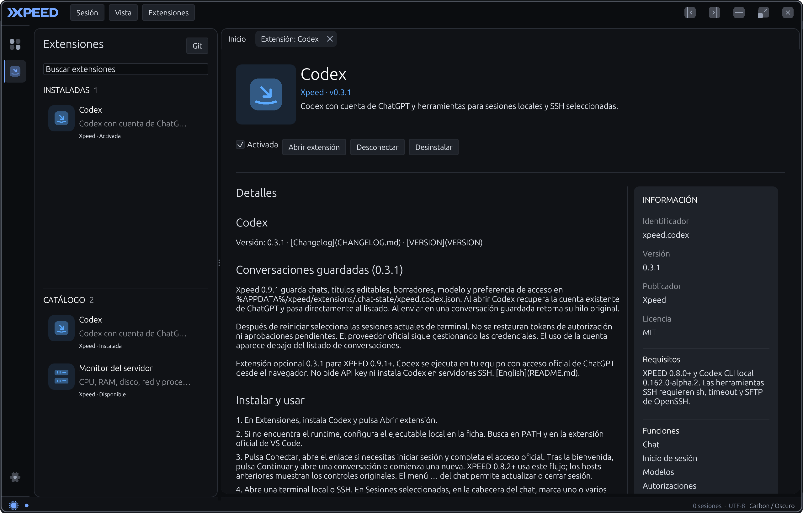
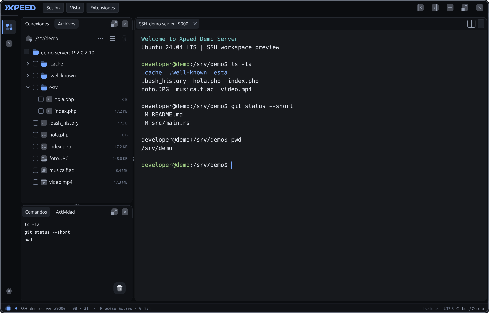
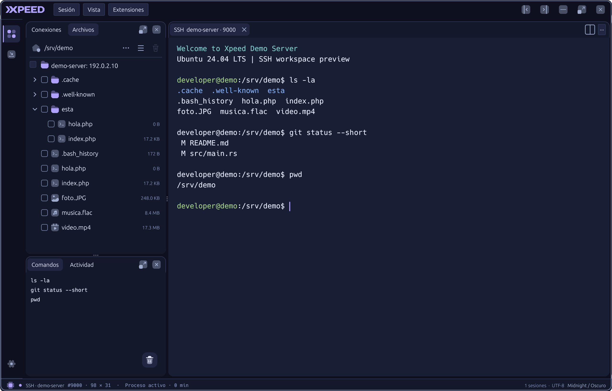
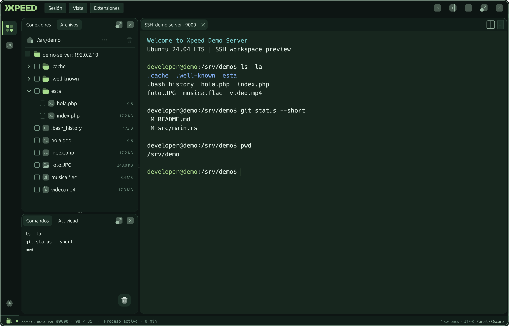
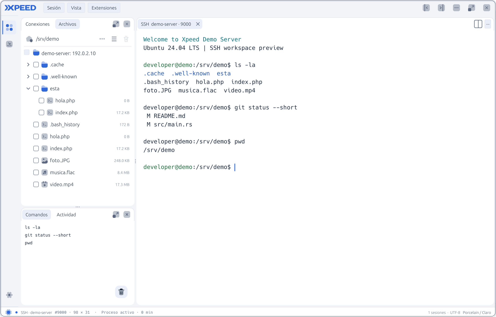
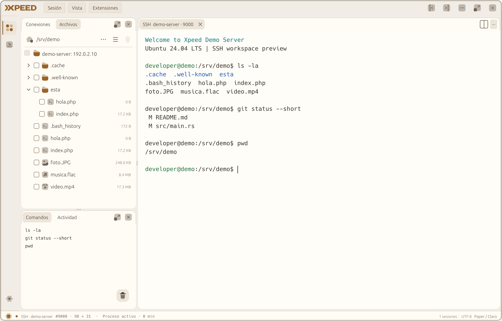
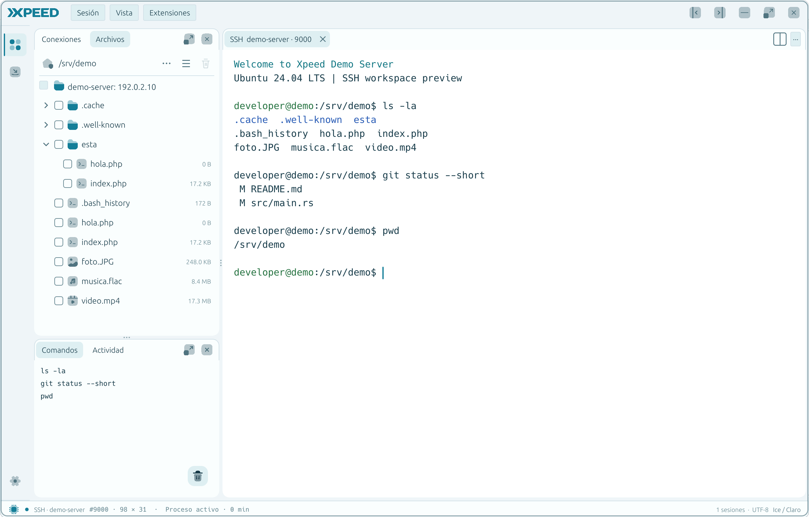

<p align="center">
  <a href="https://xpeed.ronaldbit.com">
    
  </a>
</p>

<h1 align="center">XPEED</h1>

<p align="center">
  Un espacio de trabajo nativo para terminales, servidores y archivos remotos.
</p>

<p align="center">
  <a href="https://github.com/xpeed-sh/xpeed/actions/workflows/check.yml"></a>&nbsp;
  <a href="https://github.com/xpeed-sh/xpeed/releases"></a>&nbsp;
  <a href="LICENSE"></a>
</p>

<p align="center">
  
  
  
  
</p>

<p align="center">
  <a href="#qué-es-xpeed">Acerca de</a> ·
  <a href="#funciones">Funciones</a> ·
  <a href="#galería">Galería</a> ·
  <a href="#instalación">Instalación</a> ·
  <a href="#documentación">Documentación</a>
</p>


## Qué es Xpeed

Xpeed reúne terminales locales, conexiones SSH, archivos remotos y extensiones en una sola aplicación de escritorio. Está construido en Rust y pensado para trabajar con varios servidores sin repartir el flujo entre distintas ventanas.

La interfaz permite dividir el espacio en paneles, moverlos y conservar la distribución entre sesiones. Las credenciales permanecen en el almacén seguro del sistema operativo y las operaciones de red se ejecutan fuera del hilo de la interfaz.

## Funciones

| Terminales y conexiones | Archivos remotos |
| --- | --- |
| Terminales locales y SSH independientes.<br>Pestañas, divisiones y paneles reorganizables.<br>Perfiles agrupados por proyecto y reconexión.<br>Historial persistente y búsqueda de comandos. | Navegación SFTP en árbol o cuadrícula.<br>Subida de archivos y carpetas con progreso.<br>Editor remoto con resaltado ligero.<br>Compresión y extracción ZIP, TAR.GZ y RAR. |

| Espacio de trabajo | Personalización y extensiones |
| --- | --- |
| Varias sesiones abiertas al mismo tiempo.<br>Paneles laterales y herramientas acoplables.<br>Acciones rápidas y atajos de teclado.<br>Estado de cada conexión siempre visible. | Seis temas claros y oscuros.<br>Interfaz en inglés y español.<br>Extensiones instalables desde repositorios Git.<br>Paneles propios para Codex y Monitor del servidor. |

## Galería

### Espacio de trabajo

| Modo oscuro | Modo claro |
| --- | --- |
|  |  |

### Extensiones

| Catálogo e instaladas | Información de una extensión |
| --- | --- |
|  |  |

<details>
<summary><strong>Ver los seis temas incluidos</strong></summary>

#### Oscuros

| Carbon | Midnight | Forest |
| --- | --- | --- |
|  |  |  |

#### Claros

| Porcelain | Paper | Ice |
| --- | --- | --- |
|  |  |  |

</details>

Las capturas usan información de demostración y no contienen conexiones ni credenciales reales.

## Instalación

### Windows

<a href="https://github.com/xpeed-sh/xpeed/releases/latest"></a>

Descarga `Xpeed-Setup-X.Y.Z-x64.exe` desde [Releases](https://github.com/xpeed-sh/xpeed/releases). El instalador crea los accesos directos, incluye el desinstalador y no requiere Rust ni permisos de administrador.

### Ubuntu y macOS

Xpeed se compila y prueba en CI para Windows, Ubuntu y macOS. Por ahora, la entrega instalable publicada es la de Windows; los paquetes `.deb`/AppImage y `.dmg` están pendientes. En Ubuntu y macOS puede ejecutarse desde el código.

## Compilar desde el código

Necesitas [Rust estable](https://www.rust-lang.org/tools/install), Git y las herramientas de compilación de tu sistema:

```sh
git clone https://github.com/xpeed-sh/xpeed.git
cd xpeed
cargo run --release --locked
```

En Ubuntu se requieren además las bibliotecas de ventana indicadas en la [guía de desarrollo](docs/DEVELOPMENT.md). En macOS necesitas las Command Line Tools de Xcode. Para Windows también están disponibles `scripts/dev.ps1` y los scripts de empaquetado.

## Extensiones

Xpeed proporciona el espacio de trabajo, las sesiones y una API limitada para integrar herramientas. Cada extensión vive en su propio proyecto, mantiene su versión y muestra su documentación dentro del gestor.

Consulta [Desarrollar extensiones](docs/EXTENSIONS.md) para conocer el manifiesto, las ubicaciones disponibles y el modelo de permisos.

## Documentación

- [Desarrollo y arquitectura](docs/DEVELOPMENT.md)
- [Distribución para Windows](docs/DISTRIBUTION.md)
- [Sistema de extensiones](docs/EXTENSIONS.md)
- [Idiomas y traducciones](docs/LOCALIZATION.md)
- [Historial de cambios](CHANGELOG.md)
- [Cómo contribuir](CONTRIBUTING.md)
- [Créditos](CREDITS.md) y [licencias de terceros](THIRD_PARTY.md)

## Proyecto

[Web de Xpeed](https://xpeed.ronaldbit.com) · [Organización en GitHub](https://github.com/xpeed-sh) · [Repositorio](https://github.com/xpeed-sh/xpeed)

Xpeed se distribuye bajo la [licencia MIT](LICENSE).
