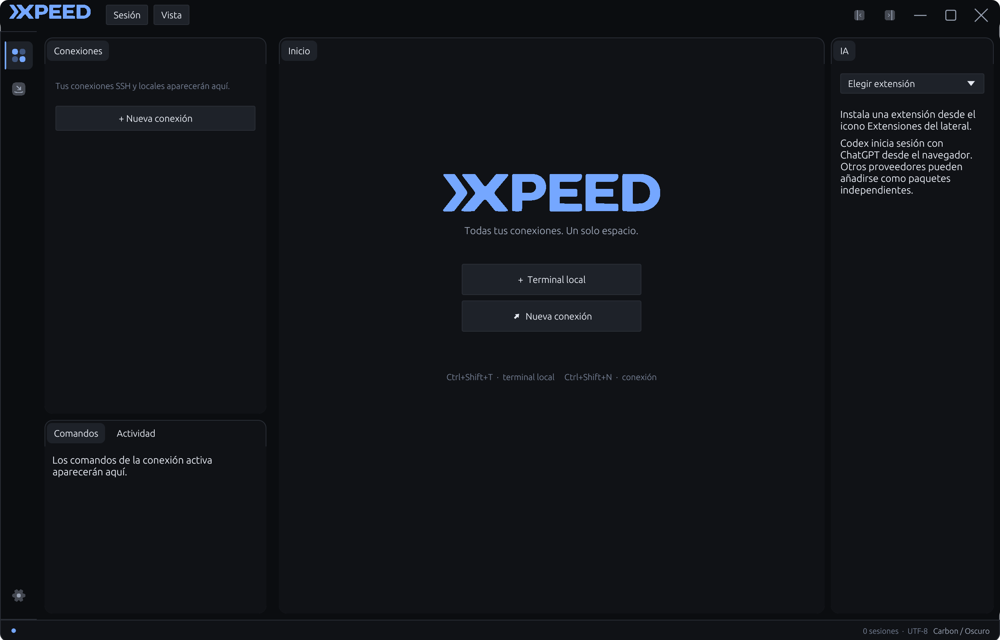

# Xpeed

Un espacio de trabajo nativo para terminales locales, conexiones SSH y archivos remotos, construido en Rust.

**Versión:** 0.10.6 · **Licencia:** [MIT](LICENSE)



## Funciones

- Terminales con pestañas, divisiones y paneles reorganizables.
- Perfiles de conexiones SSH agrupados por proyecto y reconexión configurable.
- Explorador remoto con transferencias y editor de archivos de texto.
- Historial de comandos por conexión, búsqueda y acciones rápidas.
- Temas claros y oscuros; inglés por defecto y español seleccionable en Ajustes.
- Soporte de extensiones opcionales.

## Instalar en Windows

Usa el instalador `Xpeed-Setup-0.10.6-x64.exe`. Incluye accesos directos y desinstalador. Para generar un instalador o una carpeta portátil, consulta [Distribución](DISTRIBUTION.md).

Los paquetes actuales se han validado en Windows. El proyecto incluye comprobaciones para Ubuntu y macOS; sus instaladores quedan pendientes.

## Ejecutar desde el código

Necesitas Rust estable y las herramientas de compilación de tu sistema:

```sh
cargo run --locked
```

En Windows también puedes usar `scripts/dev.ps1`. Las dependencias por plataforma, los atajos y las comprobaciones están en [Desarrollo](DEVELOPMENT.md).

## Documentación

- [Cambios por versión](CHANGELOG.md)
- [Contribuir](CONTRIBUTING.md)
- [Idiomas](LOCALIZATION.md)
- [Preparar y publicar en Git](GIT-PUBLISHING.md)
- [Créditos](CREDITS.md) y [licencias de terceros](THIRD_PARTY.md)

[Web](https://xpeed.ronaldbit.com) · [GitHub](https://github.com/xpeed-sh/xpeed)
